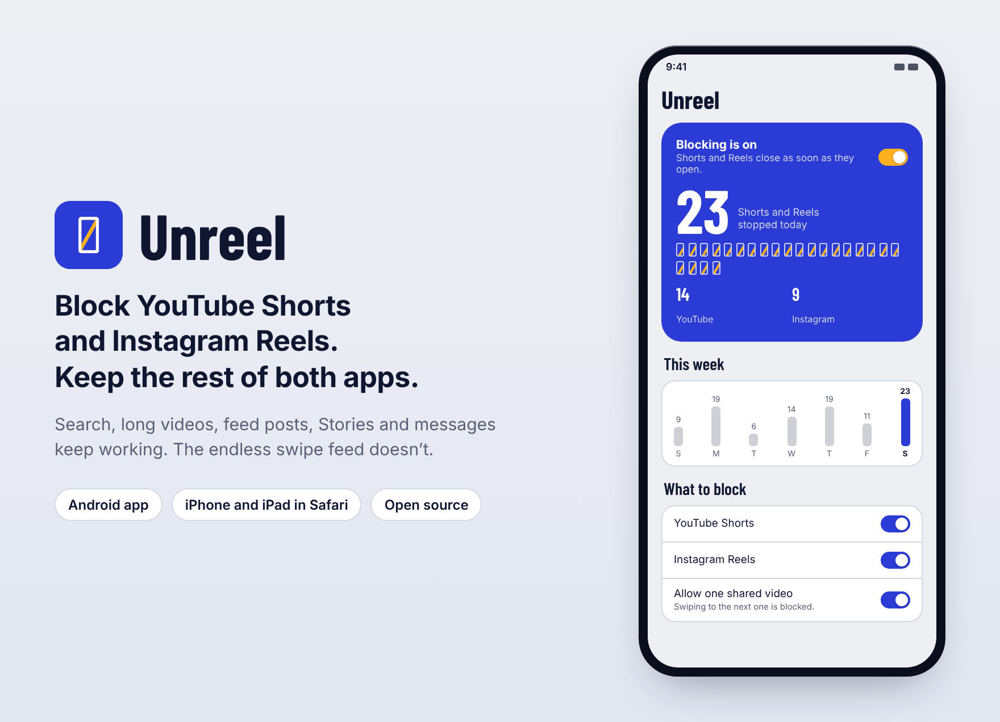
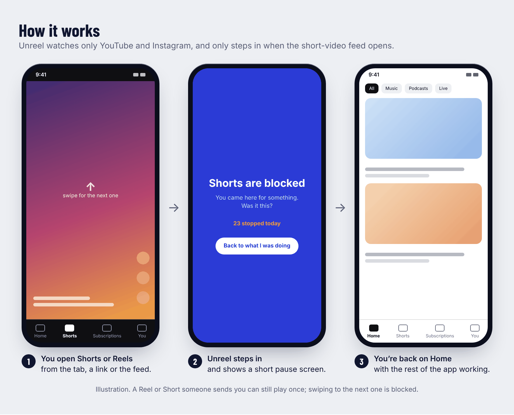
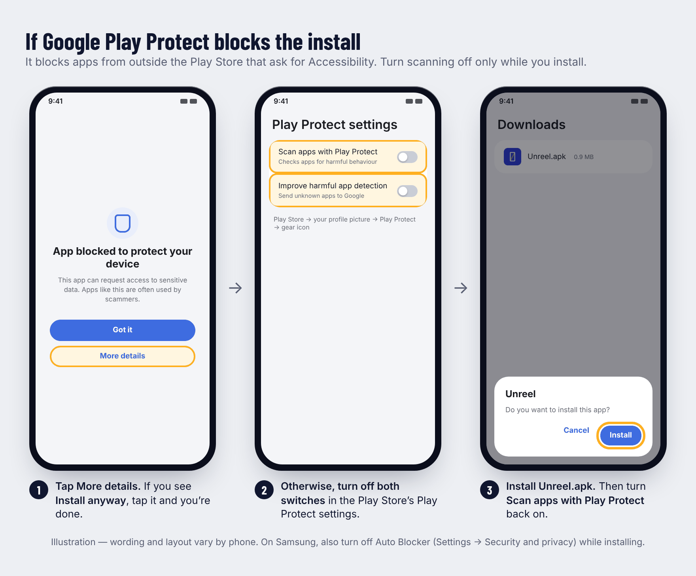
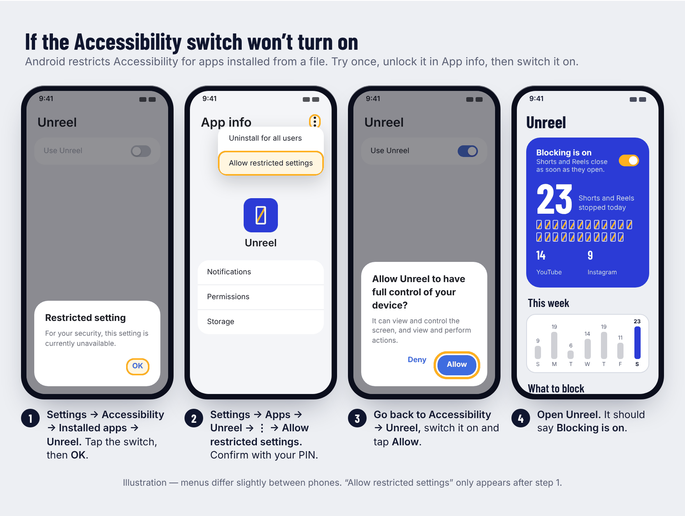
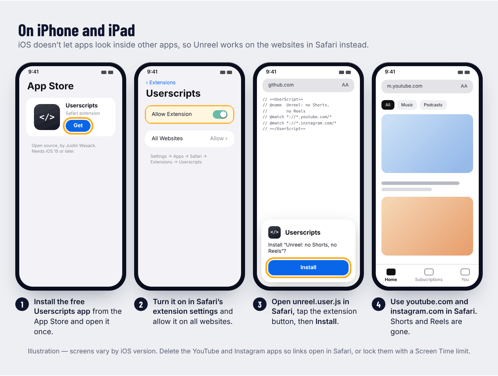

<p align="center">
  
</p>

# Unreel

Unreel stops the **YouTube Shorts** and **Instagram Reels** feeds without blocking YouTube or Instagram. Search, long videos, feed posts, Stories and messages keep working; the endless swipe feed doesn't.

| Device | What to download | Needs |
|---|---|---|
| **Android** | [`Unreel.apk`](../../releases/latest), the app | Android 8.0 or later. Doesn't use the internet |
| **iPhone, iPad, Mac** | [`unreel.user.js`](../../releases/latest/download/unreel.user.js), a script for Safari | The free [Userscripts](https://apps.apple.com/app/id1463298887) app. [Setup steps](#iphone-and-ipad) |

> Unreel isn't affiliated with YouTube, Google, Instagram or Meta.

## What it does

- **Blocks the feed, not the app.** When you open the Shorts or Reels tab, Unreel takes you back to the app's Home tab.
- **Lets one shared video through.** A Reel or Short someone sends you in a message still plays. Swiping to the next one is blocked.
- **Gives you a moment to think.** After sending you back, it shows a short full-screen pause card, or just a small message if you prefer.
- **Counts what it stopped.** Today's total, a split by app, and the last seven days.
- **Makes giving in harder.** Turning blocking off, pausing it or loosening any setting waits behind an optional PIN and an unlock delay (5 minutes by default). Then you have to confirm.
- **Pauses end by themselves.** Choose 15 minutes, 1 hour or until tomorrow, and blocking comes back on even if you never reopen Unreel.

<p align="center">
  
</p>

## Install

1. On your phone, download `Unreel.apk` from the [latest release](../../releases/latest).
2. Open it. If Android asks, allow your browser or Files app to install unknown apps.
3. If **Google Play Protect** blocks it, follow [the steps below](#if-google-play-protect-blocks-the-install).
4. Open Unreel, tap **Set up Unreel**, then **Agree and open settings**, and switch Unreel on.
5. If the switch is greyed out or shows **Restricted setting**, follow [these steps](#if-the-accessibility-switch-wont-turn-on).
6. Check it works: open YouTube and tap **Shorts**. You should land back on Home.

### If Google Play Protect blocks the install

Play Protect blocks apps installed from outside the Play Store that ask for Accessibility access, which Unreel needs to see when Shorts or Reels open. This is expected for any app like Unreel.

<p align="center">
  
</p>

1. On the warning, tap **More details**. If you see **Install anyway**, tap it and you're done.
2. Otherwise, open the **Play Store**, tap your profile picture, then **Play Protect**, then the **gear icon**.
3. Turn off **Scan apps with Play Protect** and **Improve harmful app detection**.
4. Install `Unreel.apk` again.
5. Turn **Scan apps with Play Protect** back on.

If Play Protect later asks about Unreel, choose to keep it.

**On Samsung phones**, also check **Settings → Security and privacy → Auto Blocker**. If it's on, turn it off while you install, then turn it back on.

**Still blocked?** Install from a computer instead. Apps installed this way usually skip both Play Protect's install check and the Accessibility restriction below.

1. On the phone, open **Settings → About phone → Software information** and tap **Build number** seven times to unlock Developer options.
2. Turn on **Settings → Developer options → USB debugging**.
3. On the computer, install Google's free [Android SDK Platform-Tools](https://developer.android.com/tools/releases/platform-tools).
4. Connect the phone with a USB cable, accept the prompt on the phone, then run:
   ```bash
   adb install Unreel.apk
   ```

### If the Accessibility switch won't turn on

Android restricts Accessibility for apps installed from a file. You unlock it once in the app's App info page, but that option only appears **after you've tried the switch once**.

<p align="center">
  
</p>

1. Go to **Settings → Accessibility → Installed apps → Unreel** and tap the switch. A **Restricted setting** message appears. Tap **OK**.
2. Go to **Settings → Apps → Unreel**, tap **⋮** in the top-right corner, then **Allow restricted settings**. Confirm with your PIN, pattern or fingerprint.
3. Go back to **Settings → Accessibility → Installed apps → Unreel**, switch it on and tap **Allow**.
4. Open Unreel. The blue box should say **Blocking is on**.

Menus differ slightly between phones. If you see something else:

| What you see | What to do |
|---|---|
| No **Allow restricted settings** in the ⋮ menu | Do step 1 first. If it's still missing (some recent Samsung updates hide it), install with `adb` as described above. |
| **Restricted by Advanced Protection** | Android's Advanced Protection mode blocks all apps like Unreel. The only way around it is turning that mode off in **Settings → Security and privacy**. |
| **Blocked by your admin** | The phone is managed by Family Link or a work profile. Whoever manages it has to allow Unreel. |

## Using Unreel

| Part of the screen | What it does |
|---|---|
| **Switch in the blue box** | Turning it off offers a 15-minute, 1-hour or until-tomorrow pause, or turning blocking off. All of them wait behind your PIN and delay. Turning it back on is instant. |
| **What to block** | YouTube Shorts and Instagram Reels separately, and whether one shared video may play. |
| **Make it harder to give in** | Set a PIN (give it to a friend if you don't trust yourself with it) and choose the unlock delay. Shortening the delay or removing the PIN also has to wait out the current delay. |
| **Show a pause screen** | The full-screen card after each block. Turn it off for a short message instead. |
| **Your numbers** | Everything Unreel has stopped, with a reset. |

## Privacy and permissions

- **Accessibility access is the only special access Unreel uses.** Android sends it events only from YouTube and Instagram. It reads the names of on-screen layout elements, such as whether the Reels tab is selected. It doesn't read your messages, captions or typing.
- **It acts only on the feed.** It taps Home or presses Back when the Shorts or Reels feed is on screen, and nothing else.
- **No internet.** The APK doesn't request the internet permission, so nothing it sees can leave your phone. You can check under **Settings → Apps → Unreel → Permissions**.
- **No accounts, ads or analytics.** Your counts and settings are stored only on the phone.

## Troubleshooting

**Shorts or Reels aren't being blocked.** Open Unreel and look at the blue box.
- **Android stopped the blocker:** Android or a battery saver closed Unreel. Switch Unreel off and on again in Accessibility settings. On Samsung, also set **Settings → Apps → Unreel → Battery** to **Unrestricted** so it isn't closed again.
- **Blocking is on, but a feed still opens:** YouTube or Instagram probably changed their layout in an update. Please [open an issue](../../issues) with your app versions (shown in **Settings → Apps → YouTube/Instagram**) and your phone model.

**"App not installed" when updating.** The new APK was signed with a different key than the one you have. Uninstall Unreel first, then install the new one. This resets your counts and settings.

**Checking your download.** Release APKs are signed with this certificate, SHA-256:
```
8afa5f17d2c27f0fe56c5cc94de8ac4dda2e7706274a57b54bf061517c8ae412
```
Compare it with `apksigner verify --print-certs Unreel.apk` (part of Android's build tools).

## iPhone and iPad

iOS doesn't let apps look inside other apps, so no iPhone app can block just the Shorts or Reels tab inside YouTube or Instagram. Instead, Unreel removes them from **youtube.com** and **instagram.com** in Safari, where the rest of both sites keeps working: feed, Stories, messages, search and long videos.

<p align="center">
  
</p>

1. Install **[Userscripts](https://apps.apple.com/app/id1463298887)** from the App Store. It's free and open source, needs iOS 15 or later, and runs small scripts in Safari. Open it once.
2. Go to **Settings → Apps → Safari → Extensions → Userscripts** and turn on **Allow Extension**. Under permissions, choose **All Websites → Allow**. On iOS 17 or earlier, the path is **Settings → Safari → Extensions**.
3. In Safari, open **[unreel.user.js](../../releases/latest/download/unreel.user.js)**. Tap the **AA** (or puzzle-piece) button in the address bar, choose **Userscripts**, then **Install**.
4. Open **youtube.com** or **instagram.com** in Safari. The Shorts tab, Shorts shelves and the Reels tab are gone.
   - A Short someone sends you opens as a normal video.
   - A Reel someone sends you opens as a normal post.
   - Swiping to the next one doesn't happen.

**Make it stick.**
- **Delete the YouTube and Instagram apps** so links open in Safari, where the script works.
- **Put the websites on your Home Screen:** open each site in Safari, tap **Share → Add to Home Screen**. They then open like apps.
- **Or keep the apps but lock them:** go to **Settings → Screen Time → App Limits**, add YouTube and Instagram with a 1-minute limit, and ask a friend to set the Screen Time passcode.

**Also on Mac and other browsers.** Userscripts works in Safari on macOS 12 or later. In Chrome, Firefox or Edge on a computer, install the script with [Violentmonkey](https://violentmonkey.github.io) or Tampermonkey.

**If Shorts or Reels come back,** YouTube or Instagram changed their website. [Open an issue](../../issues), and update the script once a fix is released.

**Why there's no iPhone app download.** iPhone apps can only be installed from the App Store or TestFlight, and Screen Time apps need Apple's approval first. This repository includes that app: it locks Instagram and YouTube with Screen Time and comes with a Safari extension. Building it needs a Mac with Xcode and a paid Apple Developer account; see [docs/ARCHITECTURE.md](docs/ARCHITECTURE.md).

## For developers

| Path | What it is |
|---|---|
| `native-android/` | The release APK: a framework-only Android dashboard plus `build-apk.sh` |
| `modules/unreel-blocker/android/` | The blocker shared by both Android builds: accessibility service, detection rules, overlay, stats |
| `modules/unreel-blocker/android/src/main/assets/unreel_rules.json` | The view IDs and labels Unreel matches. Update these when YouTube or Instagram change their layout |
| `src/`, `modules/unreel-blocker/ios/`, `targets/` | The Expo (React Native) app, its iOS Screen Time bridge and the iOS extensions |
| `iphone/unreel.user.js` | The Safari userscript, generated from the Safari extension by `npm run build:userscript` |
| `docs/ARCHITECTURE.md` | Platform limits, design decisions, data flow and edge cases |

**Build the release APK.**
```bash
npm install   # the dashboard's typeface comes from node_modules
KEYSTORE_PASS=… AAPT2=… ANDROID_JAR=… DX_JAR=… APKSIGNER_JAR=… KOTLINC=… ./native-android/build-apk.sh
```
The script header lists the tools it expects. It needs Kotlin 1.9 and no Gradle.

**The release signing key.** Every Android app must be signed, and Android only accepts an update if it's signed with the same key as the version already installed. Unreel's key is a `.p12` file (a password-protected key store). It's what produces the certificate fingerprint under [Checking your download](#troubleshooting).
- **Where it goes:** save it as `native-android/.keystore/unreel.p12`, or point the build at it with `KEYSTORE=/path/to/key.p12`. Pass its password as `KEYSTORE_PASS`. If no key exists there, the script creates a new one, which can't update existing installs.
- **Sign every release with it.** An APK signed with any other key fails with "App not installed" for everyone who has Unreel, until they uninstall and lose their settings.
- **Back it up.** If the key is lost, existing users can never get an update again.
- **Never publish it.** Don't commit it (it's already in `.gitignore`), attach it to a release or share its password. Anyone who has both can make an APK that phones accept as a genuine Unreel update.
- **Change the password** with `keytool -storepasswd -keystore native-android/.keystore/unreel.p12`.

**Build the Expo app.**
```bash
npm install
npm run android                                          # local development build
npx eas-cli@latest build -p android --profile preview    # APK built in Expo's cloud
```
The **Android APK** GitHub Actions workflow builds it too. That APK is signed with a different key, so it can't update the release APK.

**When detection breaks after an app update.**
1. Run a debug build and open the screen that isn't caught.
2. Run `adb logcat -s UnreelDiag`. It prints the view IDs on screens that nothing matched.
3. Add the new ID to `unreel_rules.json` and raise `version`.

## Licences

Unreel's fonts (Barlow Condensed) and bundled libraries are free for personal and commercial use. See [THIRD_PARTY_NOTICES.md](THIRD_PARTY_NOTICES.md) for each licence and what it asks.
