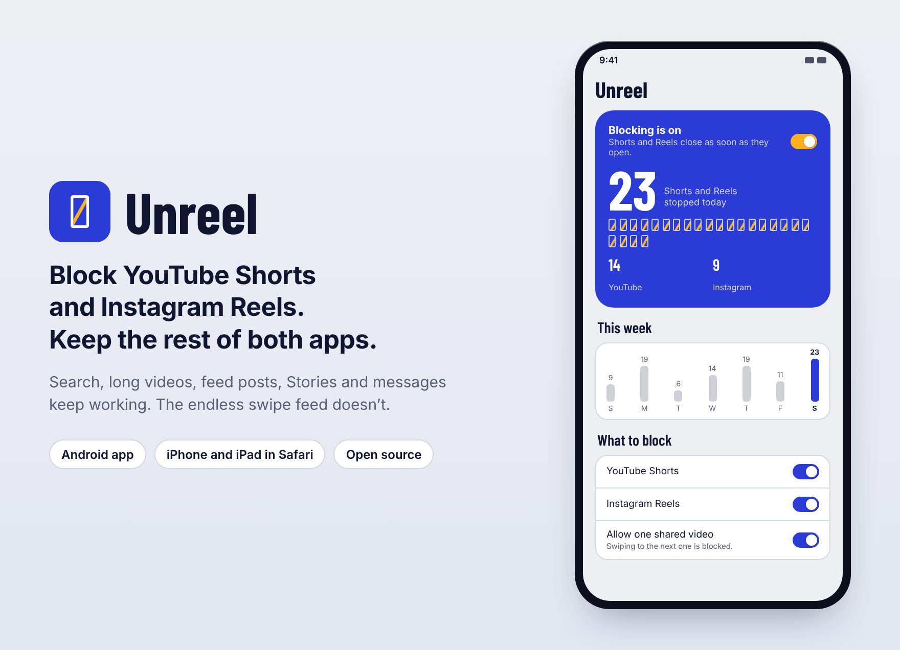
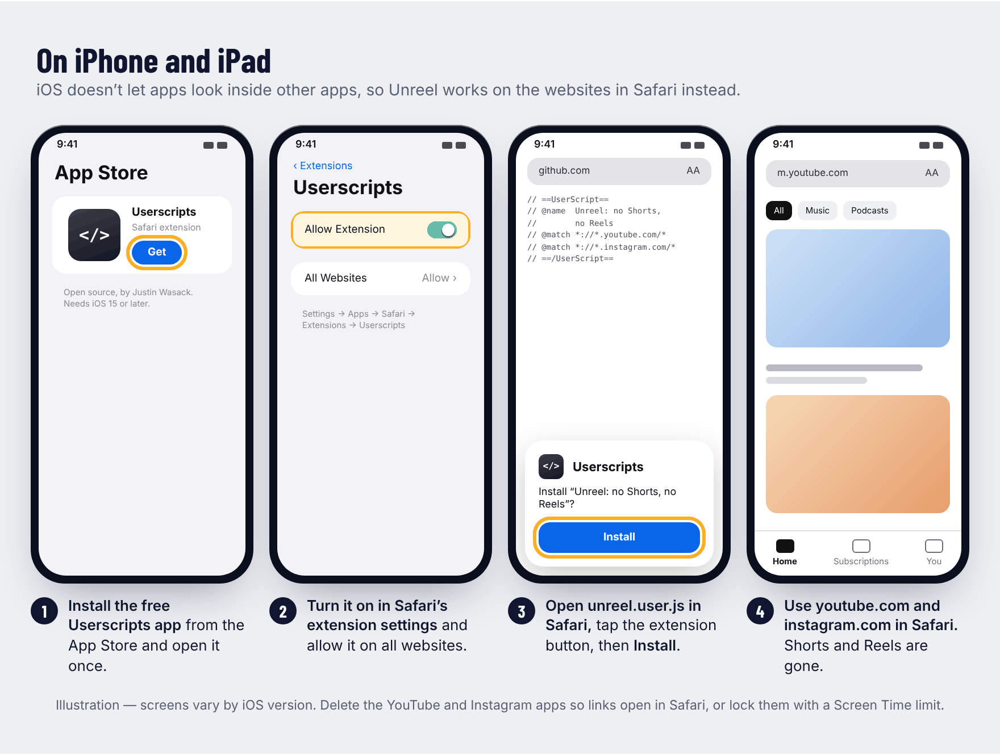
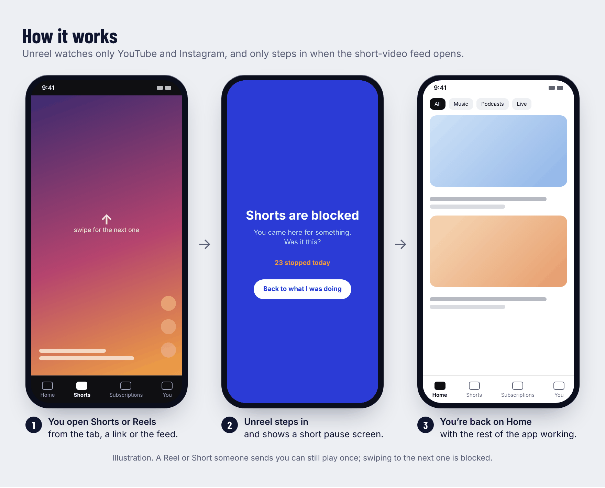

  

# Unreel

Unreel stops the **YouTube Shorts** and **Instagram Reels** feeds without blocking YouTube or Instagram. Search, long videos, posts, Stories and messages keep working; the endless swipe feed doesn't. Free, open source, no ads and no tracking.

| Your device | How it works | Get it |
|---|---|---|
| **iPhone or iPad** | Removes Shorts and Reels on **youtube.com** and **instagram.com** in Safari | **[Setup guide](https://tymonbitesthedust.github.io/Unreel/)** (open it on your iPhone) · [steps below](#iphone-and-ipad) |
| **Android** (8.0 or later) | An app that closes the Shorts and Reels feeds inside the YouTube and Instagram apps | **[Unreel.apk](../../releases/latest)** · [steps below](#android) |
| **Mac or PC** | The same script as iPhone, in your browser | [steps below](#mac-and-pc) |

> Unreel isn't affiliated with YouTube, Google, Instagram or Meta.

## iPhone and iPad

iPhone doesn't let apps look inside other apps, so no app can remove just the Shorts tab from the YouTube app. Unreel works on the **websites** in Safari instead, where everything else keeps working.

**Easiest:** open the **[setup guide](https://tymonbitesthedust.github.io/Unreel/)** on your iPhone. It has these steps with tap-to-open buttons.

  

1. **Get the free [Userscripts](https://apps.apple.com/app/id1463298887) app** from the App Store (iOS 15 or later) and open it once.
2. **Turn it on:** open **Settings → Apps → Safari → Extensions → Userscripts**, switch on **Allow Extension**, and set **All Websites** to **Allow**. (iOS 17 or earlier: **Settings → Safari → Extensions**.)
3. **Install the script:** in Safari, open **[unreel.user.js](../../raw/HEAD/iphone/unreel.user.js)**. A page of code appears; that's normal. Tap the **AA** or puzzle-piece button in the address bar, choose **Userscripts**, then **Install**.
4. **Use the websites:** type **youtube.com** or **instagram.com** into Safari's address bar. The Shorts tab, Shorts shelves and the Reels tab are gone. A Short or Reel a friend sends you still opens, as a normal video or post.

**Screen time:** a small blue badge at the bottom of youtube.com and instagram.com shows how long you've spent there today. Tap it to see the parts, the same as on Android (YouTube: Shorts, Videos, Not watching; Instagram: Scrolling Reels, Posts & Stories, Chat, Other), today or over the last 7 days. It counts only while the site is open and in use, and each site and browser keeps its own count.

### Keep it working

The YouTube and Instagram **apps** still have their feeds. Pick one:

- **Delete the YouTube and Instagram apps (best).** Links then open in Safari, where Unreel works.
- **Add the websites to your Home Screen, with a pause.** In Safari, open the [YouTube pause](https://tymonbitesthedust.github.io/Unreel/pause/?app=youtube) or [Instagram pause](https://tymonbitesthedust.github.io/Unreel/pause/?app=instagram) page. Tap **⋯** next to the address bar → **Share** → **Add to Home Screen** (on older iPhones, the **Share** button is at the bottom). Turn **Open as Web App off**, so it opens in Safari where Unreel works, then tap **Add**. Each time you open it, it counts and waits 10 seconds before letting you in.
- **Keeping the apps? Send them to the pause page.** In the **Shortcuts** app, tap **Automation → +**, choose **App → YouTube → Is Opened → Run Immediately**, then **New Blank Automation**, add **Open URLs** and paste `https://tymonbitesthedust.github.io/Unreel/pause/?app=youtube&from=app`. Repeat for Instagram with `app=instagram`. The [setup guide](https://tymonbitesthedust.github.io/Unreel/) has copy buttons for both links.
- **Or lock the apps with Screen Time:** **Settings → Screen Time → App Limits → Add Limit**, choose YouTube and Instagram, set 1 minute, and ask a friend to set the Screen Time passcode.

**Updates** arrive by themselves through Userscripts. If you installed Unreel before version 1.1, install it once more from step 3 to get them.

## Android

1. On your phone, download **Unreel.apk** from the [releases page](../../releases/latest) and open it. That one file is all you need; skip the "Source code" downloads under it. If Android asks, allow your browser or Files app to install apps.
2. Open Unreel, tap **Set up Unreel**, then **Agree and open settings**, and switch Unreel on.
3. Check it works: open YouTube and tap **Shorts**. You should land back on Home.

**Updating from 1.0.0?** Uninstall Unreel 1.0.0 first, then install the new one. Version 1.1.0 is signed with a new key, so Android can't install it over 1.0.0. Uninstalling resets your counts and settings. Later updates install over 1.1.0 as normal.

**Stuck?** If Play Protect blocks the install or the switch is greyed out, see **[Android help](docs/ANDROID-HELP.md)**.

What the Android app does:

- **Blocks the feed, not the app.** Opening the Shorts or Reels tab takes you back to Home. One video a friend sends you still plays; swiping to the next is blocked.
- **Gives you a moment to think** with a short pause card, and **counts** what it stopped today and this week.
- **Or allows a little each day,** if quitting all at once is too hard. Turn on **Time limits** and Shorts and Reels play for up to 1 hour a day and 10 minutes in each hour (you choose the amounts; YouTube and Instagram share them). When the time is up, they're blocked until the next hour, or until tomorrow. Lowering a limit works straight away; raising one waits like any other loosening.
- **Makes giving in harder:** turning blocking off or loosening a setting waits behind an optional PIN and a 5-minute delay. Pauses end by themselves.
- **Shows your screen time,** today or over the last 7 days, split into parts. YouTube: **Shorts**, **Videos** and **Not watching** (browsing, searching). Instagram: **Scrolling Reels**, **Posts & Stories** (including one Reel opened from a post or chat), **Chat** and **Other**. It's counted whether or not blocking is on.
- **Puts it on your Home screen** with a widget: today's YouTube and Instagram time, split into the same parts, and how many Shorts and Reels were stopped. Tap it to open Unreel.

**Add the widget** (Samsung and other Android phones): touch and hold an empty spot on the Home screen, tap **Widgets**, find **Unreel**, choose **Screen time** and tap **Add**. It opens at 4×2; touch and hold it, then drag the edges to resize. Smaller, it shows each app's total; taller, it adds the bars and the parts.

  

## Mac and PC

- **Safari on a Mac** (macOS 12 or later): install [Userscripts](https://apps.apple.com/app/id1463298887), turn it on in **Safari → Settings → Extensions**, then follow iPhone steps 3 and 4.
- **Chrome, Edge or Firefox:** install [Violentmonkey](https://violentmonkey.github.io), then open [unreel.user.js](../../raw/HEAD/iphone/unreel.user.js); it offers to install the script.

The screen time badge works the same on a computer. Only the window you're using counts, so two tabs side by side aren't counted twice, and a tab left open while you're away stops counting after 5 minutes unless a video is playing.

## Privacy

- **iPhone and computers:** the script runs only on youtube.com and instagram.com, inside your browser, and sends nothing anywhere. Screen time is kept in your browser's storage for each site (YouTube's and Instagram's own pages can see that storage, as they can any of their site data).
- **Android:** Accessibility access is the only special permission. Android sends Unreel events only from YouTube and Instagram; it reads the names of on-screen layout elements (such as whether the Reels tab is selected), not your messages or typing. It also times how long you spend in each part of YouTube and Instagram, for Screen time and time limits, and keeps those times on the phone. The app has no internet permission, so nothing can leave your phone.
- No accounts, ads or analytics anywhere.

## Something not working?

- **Shorts or Reels came back:** YouTube or Instagram changed their app or site. [Open an issue](../../issues) with your phone model and app versions.
- **Android:** see [Android help](docs/ANDROID-HELP.md#troubleshooting).
- **iPhone, the YouTube or Instagram app opens instead of the website:** the app is still installed. Delete it, or type the address into Safari yourself.

## For developers

How to build, test and publish: [docs/DEVELOPING.md](docs/DEVELOPING.md). Design and platform limits: [docs/ARCHITECTURE.md](docs/ARCHITECTURE.md). Licences: [THIRD_PARTY_NOTICES.md](THIRD_PARTY_NOTICES.md).
